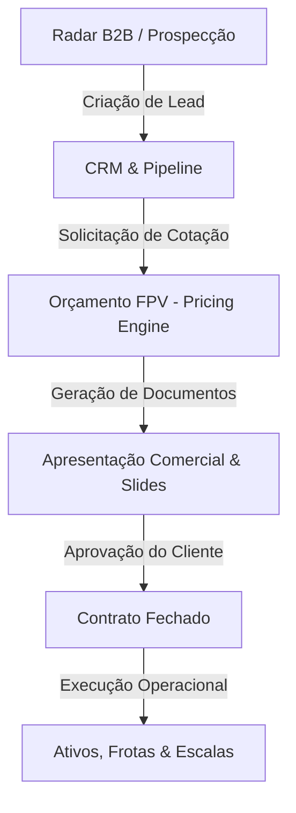

# 🏛️ Mapa de Arquitetura e Guia do Desenvolvedor — SmartBid

> **Versão do Documento:** 1.0.0  
> **Última Atualização:** Novembro/2026  
> **Finalidade:** Servir como guia definitivo de arquitetura, organização de pastas e governança de código para manutenção, evolução modular e integração de novos desenvolvedores.

---

## 📌 1. Visão Geral do Sistema

O **SmartBid** é uma plataforma corporativa B2B voltada para:
1. **Inteligência Comercial & CRM:** Prospecção ativa de clientes via mapas, enriquecimento de leads e funil de vendas.
2. **Engenharia de Custos & Orçamentos (FPV):** Motor de cálculo complexo de planilhas de custos de mão de obra terceirizada, encargos sociais, benefícios, uniformes, EPIs, insumos, impostos e BDI com base em Convenções Coletivas de Trabalho (CCTs).
3. **Apresentações Comerciais:** Gerador de propostas comerciais visuais interativas, slides e documentos formais para impressão em formato A4.
4. **Gestão Operacional:** Acompanhamento de contratos fechados, frotas/ativos com geolocalização e escalas de postos de trabalho.

---

## 💻 2. Stack Tecnológica

| Camada | Tecnologia | Detalhes |
| :--- | :--- | :--- |
| **Framework Web** | Next.js (App Router) | React 18 / 19, Server Components e Server Actions |
| **Linguagem** | TypeScript | Tipagem estrita em todo o fluxo de dados |
| **Banco de Dados** | PostgreSQL (Neon Serverless) | Modelagem relacional com conexão poolizada |
| **ORM** | Prisma ORM | Modelos tipados e migrações estruturadas |
| **Estilização** | TailwindCSS + CSS Modules | Layout responsivo, animações e temas |
| **Autenticação & Sessão**| JWT em Cookies HTTP-Only | Criptografia Bcrypt + Tokens de Sessão com controle de Tenant |
| **E-mails Transacionais**| Nodemailer via SMTP | Contas corporativas gerenciadas no banco (`SmtpAccount`) |

---

## 🗂️ 3. Mapeamento de Domínios por Área de Manutenção

O código é estritamente separado por **Áreas de Negócio**. Se você precisa dar manutenção em uma área específica, consulte as rotas e arquivos listados abaixo:

### 💼 ÁREA 1: Comercial & CRM
Gerencia a captação de clientes, funil de vendas e elaboração de apresentações.

| Rota / Pasta | Responsabilidade | Arquivos Principais |
| :--- | :--- | :--- |
| `app/leads/` | Tabela e Kanban de Leads, enriquecimento de contatos e histórico de interações | `page.tsx`, `actions.ts`, `components/prospeccao/` |
| `app/pipeline/` | Funil de vendas por fases (Qualificação, Proposta, Negociação, Ganho/Perdido) | `page.tsx`, `actions.ts` |
| `app/prospeccao/` | Radar B2B (busca integrada no Google Maps e Bing para encontrar empresas) | `page.tsx`, `actions.ts` |
| `app/clientes/` | Cadastro geral de clientes, CNPJ, contatos e endereços vinculados | `page.tsx`, `actions.ts` |
| `app/propostas-comerciais/` | Visualizador de apresentações, slides interativos (Canva) e PDF A4 | `[id]/page.tsx`, `components/DocumentoA4.tsx` |

---

### 🧮 ÁREA 2: Engenharia de Custos & Orçamentação Técnica (Core FPV)
É o coração matemático e orçamentário da plataforma. **Exige máxima cautela em alterações.**

| Rota / Pasta | Responsabilidade | Arquivos Principais |
| :--- | :--- | :--- |
| `lib/pricingEngine.ts` | **MOTOR MATEMÁTICO:** Cálculo de Módulo 1 (Salário), Módulo 2 (Encargos/Benefícios), Uniformes, Materiais, Tributos e Margem de Lucro | `lib/pricingEngine.ts` |
| `app/propostas/` | Criação e edição de propostas orçamentárias detalhadas por posto/cargo | `page.tsx`, `actions.ts`, `[id]/page.tsx` |
| `app/ccts/` & `lib/cctParser.ts` | Cadastro e leitura inteligente de Convenções Coletivas de Trabalho | `app/ccts/page.tsx`, `components/cct/` |
| `app/produtos/` | Catálogo de insumos e materiais de limpeza/consumo | `page.tsx`, `actions.ts` |
| `app/epis/` | Catálogo de Equipamentos de Proteção Individual e uniformes | `page.tsx`, `actions.ts` |

---

### 🚚 ÁREA 3: Operação, Ativos & Contratos
Gerencia o pós-venda, a execução dos serviços contratados e recursos operacionais.

| Rota / Pasta | Responsabilidade | Arquivos Principais |
| :--- | :--- | :--- |
| `app/contratos/` | Gestão de contratos ativos, reajustes anuais e faturamento mensal | `page.tsx`, `actions.ts` |
| `app/ativos/` | Controle de frotas de veículos, máquinas, vistorias e mapas de rotas | `page.tsx`, `actions.ts` |
| `app/entrega/` | Rastreamento de entregas de materiais e ordens operacionais | `page.tsx`, `actions.ts` |
| `app/escalas/` | Controle de escalas de trabalho e escalas de postos | `page.tsx`, `actions.ts` |

---

### 🛡️ ÁREA 4: Segurança, Autenticação & Multi-Tenant
Responsável pela blindagem dos dados corporativos e controle de acesso.

| Rota / Pasta | Responsabilidade | Arquivos Principais |
| :--- | :--- | :--- |
| `lib/security.ts` | Hashing de senhas (Bcrypt), validação de política forte e trava contra força bruta (5 tentativas / 15 min) | `lib/security.ts` |
| `lib/sessionUser.ts` | Resolução do usuário logado e injeção do `tenantId` da empresa ativa | `lib/sessionUser.ts` |
| `app/api/auth/login/` | Endpoint de login seguro, validação de bloqueio e emissão de JWT | `route.ts` |
| `components/ForcePasswordChangeModal.tsx` | Modal obrigatório de troca de senha com checklist de requisitos em tempo real | `ForcePasswordChangeModal.tsx` |
| `prisma/schema.prisma` | Definição de todos os esquemas relacionais e regras de integridade | `prisma/schema.prisma` |

---

### ⚙️ ÁREA 5: Administração & Configurações da Empresa
Cadastros estruturais e personalizações do ambiente.

| Rota / Pasta | Responsabilidade | Arquivos Principais |
| :--- | :--- | :--- |
| `app/admin/usuarios/` | Cadastro, ativação/desativação e definição de papéis (Admin, Operador, Vendedor) | `page.tsx`, `actions.ts` |
| `app/admin/empresas/` | Gestão de empresas do grupo (CNPJ, razão social, logotipo e endereço para timbrado) | `page.tsx`, `actions.ts` |
| `app/admin/settings/` | Configurações gerais do sistema e contas de e-mail SMTP | `page.tsx`, `actions.ts` |

---

## 🔒 4. Padrões de Segurança Multi-Tenant (Regra de Ouro)

> ⚠️ **ATENÇÃO DESENVOLVEDOR:** O SmartBid é um sistema multi-empresa. Dados de uma empresa NUNCA podem vazar para outra.

Ao escrever qualquer consulta ou mutação no banco de dados (`prisma`):
1. **Sempre inclua `tenantId` no `where`:**
   ```typescript
   // ❌ ERRADO (Permite vazamento entre empresas)
   const propostas = await prisma.proposta.findMany();

   // ✅ CORRETO (Isolamento estrito)
   const session = await getSessionUser();
   const propostas = await prisma.proposta.findMany({
     where: { tenantId: session.tenantId }
   });
   ```
2. **Anti-Enumeração de Usuários (OWASP):** Mensagens de falha de login ou recuperação de senha NUNCA devem informar se o e-mail existe ou não. Use sempre mensagens neutras (ex: *"E-mail ou senha incorretos"*).

---

## 🔄 5. Ciclo de Vida da Informação (Data Flow)



---

## 🚀 6. Boas Práticas para Evitar Quedas e Problemas em Produção

1. **Validação Prévia Obrigatória:** Antes de fazer qualquer commit ou deploy, execute a verificação estrita:
   ```bash
   npm run build
   ```
   Se o build apresentar qualquer erro de TypeScript ou sintaxe, **não suba o código**.
2. **Cuidado com Alterações no Prisma Schema:**
   - Adições de colunas devem ser opcionais (`?`) ou possuir valor `@default(...)`.
   - Nunca remova ou renomeie campos críticos sem plano de migração de dados.
3. **Não modifique a lógica do `pricingEngine.ts` sem validação matemática:** Qualquer alteração nas fórmulas de impostos ou encargos reflete diretamente no valor de todas as propostas comerciais do sistema.
4. **Desacoplamento de Componentes Monolíticos:** Ao dar manutenção em componentes grandes como `components/Sidebar.tsx`, extraia as novas regras para subcomponentes isolados em vez de inflar o arquivo principal.
